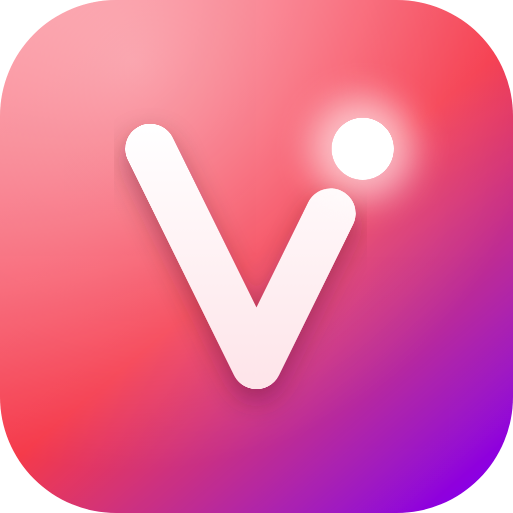
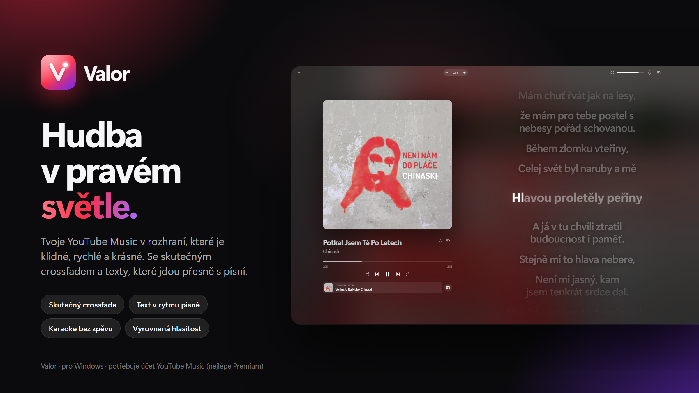
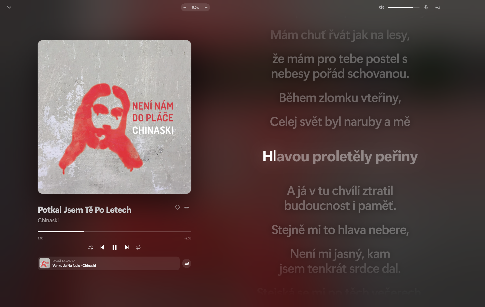

  

<h1 align="center">Valor</h1>

Přehrávač hudby ve stylu Applu nad YouTube Music. Tvůj účet a Premium, ale úplně nové rozhraní.

  

> **Neoficiální projekt.** Není spojen s YouTube ani Googlem. Přečti si [DISCLAIMER](DISCLAIMER.md).

## Co umí

- **Opravdový crossfade** – dvě skladby se překrývají, jedna se postupně ztlumuje, druhá nabíhá.
- **Texty písní synchronizované po slovech** (LRCLib, NetEase, YouTube Music), celá obrazovka, posun časování.
- **Karaoke režim** – odstraní zpěv, nechá instrumentálku, text jde na celou obrazovku.
- **Vyrovnání hlasitosti** mezi skladbami a **10pásmový ekvalizér** s presety.
- **Anonymní režim bez reklam** – funguje i bez přihlášení, reklamy se blokují.
- **Menu „…“ u každé písničky** – přehrát jako další, do fronty, do playlistu, na interpreta / album, odebrat z playlistu, nelíbí se mi.
- **Fronta** – odebírání, uložení fronty jako playlist, obnova fronty a pozice po restartu.
- **Windows integrace** – ovládání médií, tlačítka na náhledu v hlavním panelu, ikona v oznamovací oblasti, mini přehrávač.
- **Scrobbling** (ListenBrainz) a **Discord Rich Presence**.
- **Vlastní klávesové zkratky**, automatické aktualizace z GitHub Releases.

  

## Instalace

1. Stáhni [`release/Valor-Setup-0.1.0.exe`](release/Valor-Setup-0.1.0.exe) (nebo ze záložky *Releases*).
2. Spusť instalátor a projdi průvodcem.
3. Windows SmartScreen může upozornit, že aplikace není podepsaná – *Další informace → Přesto spustit*.

## Přihlášení

Valor funguje i **anonymně** (bez účtu, s blokací reklam). Pro vlastní knihovnu, lajky a playlisty se
přihlas v aplikaci; přihlášení probíhá na stránkách Googlu a Valor heslo nevidí.
Google může přihlášení ve vložených oknech občas odmítnout – pak to zkus znovu, případně použij anonymní režim.

## Co je zatím nezkoušené / chybí

- Last.fm scrobbling (potřebuje API klíč), je jen ListenBrainz.
- Discord Rich Presence vyžaduje vlastní *Application ID* z Discord Developer Portalu.
- Instalátor není podepsaný certifikátem.

## Vývoj

Electron + React 19 + Vite + Tailwind v4 + Radix. Hudba i účet jdou přes skrytá okna s music.youtube.com.

## Licence

[MIT](LICENSE) – ale čti [DISCLAIMER](DISCLAIMER.md).
